# DARKee · Chrome extension / extension Chrome

**🇬🇧 English · 🇫🇷 Français** (plus bas / scroll down)

---

## 🇬🇧 At last.

It's 11 pm. You open your inbox. And a white wall burns straight through your retinas.

For years we tried everything: themes that break pages, photos turned into negatives, extensions that read every
site you visit. We squinted. We turned the brightness down. We suffered.

**No more.**

**DARKee** turns your pages dark, cleanly, and only the ones you want. Photos and videos keep their true colours.
When evening comes, it switches on by itself. And while it's at it, it rejects cookie banners for you.

No network requests. No data sent. No ads. Free. Open source.
**Because that's the way it should be.**

### Main features
- 🌙 **One click, and the page goes dark.** Another click, and it's light again. Your choice is remembered per site.
- 🖼️ **Photos and videos keep their true colours**, or are just dimmed: your call.
- 🎚️ **5 themes** (Graphite, OLED, Soft, Warm, Midnight) and fine tuning: brightness, contrast, saturation, hue, temperature.
- 🌐 **Google and Wikipedia out of the box** (Gmail, Calendar, Docs, Sheets, Slides, Drive, Keep, Translate…), then **any site** on demand: one site, or its whole domain.
- ⏰ **Automatic**: by the clock, at sunrise and sunset, or with your system's dark theme.
- 🍪 **Cookie blocker**: cookie banners are rejected automatically. Never "Accept", and never a paid "reject".

### Advanced features
- 🪟 **Matching title bar** for installed web apps (Gmail, Calendar…), adjustable per site.
- ⌨️ **Keyboard shortcuts**: `Alt+Shift+D` for this site, `Alt+Shift+A` for everywhere (customisable).
- 🧪 **Three renderers**: Precise, Recolour or Compatible, chosen per site.
- 🌗 **Already-dark sites are left alone**, no double darkening.
- 📚 **Wikipedia**: turns on Wikipedia's own dark theme, or DARKee's filter if you prefer.
- 📄 **Docs, Sheets, Slides**: images drawn by the editor get their true colours back too.

### Privacy
DARKee makes **no network requests**. Nothing is sent, anywhere. To name your city (for sun times) it uses a
built-in list of cities, offline.
Permissions: storage, scripts on Google and Wikipedia, and `geolocation` only if you click "Locate me". Access to
other sites is only requested when you turn it on, one site at a time or all of them.

### Install DARKee in Chrome (2 minutes)
DARKee is not on the Chrome Web Store (yet): you install it by hand, it's easy.

1. **Download**: open [the latest release](../../releases/latest) and click the `DARKee-x.y.z.zip` file.
2. **Unzip**: right-click the downloaded file › **Extract All…** › **Extract** (on a Mac: double-click).
   A `DARKee` folder appears. Put it somewhere it will stay (Documents, for example):
   Chrome reads it at every start, so don't delete it.
3. **Open extensions**: type `chrome://extensions` in Chrome's address bar and press Enter.
4. **Developer mode**: top right of that page, switch on **Developer mode**.
5. **Load**: click **Load unpacked** (top left), pick the `DARKee` folder, then **Select Folder**.
6. **Pin it**: click the puzzle piece 🧩 at the top right of Chrome, then the pin 📌 next to DARKee. Done!

**Update**: download the new version, replace the content of the `DARKee` folder, then click DARKee's ↻ arrow in `chrome://extensions`.

The interface is in French.

> DARKee is not affiliated with Google or the Wikimedia Foundation. Google, Gmail and Chrome are trademarks of Google LLC;
> Wikipedia is a trademark of the Wikimedia Foundation.

## 🇫🇷 Enfin.

Il est 23 h. Vous ouvrez votre messagerie. Et là, un mur blanc vous brûle les rétines.

Pendant des années, on a tout essayé : des thèmes qui cassent les pages, des photos devenues négatives, des
extensions qui lisent tout ce que vous visitez. On a plissé les yeux. On a baissé la luminosité. On a souffert.

**C'est terminé.**

**DARKee** passe vos pages en sombre, proprement, et seulement celles que vous voulez. Les photos et les vidéos
gardent leurs vraies couleurs. Le soir venu, il s'allume tout seul. Et au passage, il refuse les bandeaux de cookies
à votre place.

Aucune requête réseau. Aucune donnée envoyée. Sans pub. Gratuit. Libre.
**Parce que c'est comme ça que ça devrait être.**

### Les fonctions principales
- 🌙 **Un clic, et la page passe en sombre.** Un autre clic, et elle redevient claire. Le choix est mémorisé pour chaque site.
- 🖼️ **Les photos et les vidéos gardent leurs vraies couleurs**, ou sont simplement assombries : c'est vous qui choisissez.
- 🎚️ **5 thèmes** (Graphite, OLED, Doux, Chaud, Bleu nuit) et des réglages fins : luminosité, contraste, saturation, teinte, température.
- 🌐 **Google et Wikipédia d'office** (Gmail, Agenda, Docs, Sheets, Slides, Drive, Keep, Traduction…), puis **n'importe quel site** sur simple activation : un site, ou tout son domaine.
- ⏰ **Automatique** : selon l'heure, le lever et le coucher du soleil, ou le thème sombre du système.
- 🍪 **Anti-cookies** : les bandeaux de cookies sont refusés automatiquement. Jamais « Accepter », et jamais un « refuser » payant.

### Les fonctions avancées
- 🪟 **Barre de titre assortie** pour les web apps installées (Gmail, Agenda…), réglable site par site.
- ⌨️ **Raccourcis clavier** : `Alt+Maj+D` pour ce site, `Alt+Maj+A` pour partout (modifiables).
- 🧪 **Trois rendus** : Précis, Recolorer ou Compatible, au choix pour chaque site.
- 🌗 **Un site déjà sombre est laissé tel quel**, sans double assombrissement.
- 📚 **Wikipédia** : active le thème sombre officiel de Wikipédia, ou le filtre de DARKee au choix.
- 📄 **Docs, Sheets, Slides** : les images dessinées par l'éditeur sont elles aussi remises dans leurs vraies couleurs.

### Vie privée
DARKee ne fait **aucune requête réseau**. Rien n'est envoyé, nulle part. Pour trouver le nom de votre ville
(heures du soleil), il utilise une liste de villes intégrée, sans connexion.
Autorisations : stockage, scripts sur Google et Wikipédia, et `geolocation` seulement si vous cliquez sur
« Me localiser ». L'accès aux autres sites n'est demandé que si vous l'activez, un site à la fois ou tous.

### Installer DARKee dans Chrome (2 minutes)
DARKee n'est pas (encore) sur le Chrome Web Store : on l'installe à la main, c'est simple.

1. **Télécharger** : ouvrir [la dernière version](../../releases/latest) et cliquer sur le fichier `DARKee-x.y.z.zip`.
2. **Décompresser** : clic droit sur le fichier téléchargé › **Extraire tout…** › **Extraire** (sur Mac : double-clic).
   Un dossier `DARKee` apparaît. Le ranger dans un endroit où il ne bougera plus (par exemple Documents) :
   Chrome le relit à chaque démarrage, il ne faut pas le supprimer.
3. **Ouvrir les extensions** : taper `chrome://extensions` dans la barre d'adresse de Chrome, puis Entrée.
4. **Mode développeur** : en haut à droite de cette page, allumer l'interrupteur **Mode développeur**.
5. **Charger** : cliquer sur **Charger l'extension non empaquetée** (en haut à gauche), choisir le dossier `DARKee`, puis **Sélectionner un dossier**.
6. **Épingler** : cliquer sur la pièce de puzzle 🧩 en haut à droite de Chrome, puis sur la punaise 📌 à côté de DARKee. C'est prêt !

**Mettre à jour** : télécharger la nouvelle version, remplacer le contenu du dossier `DARKee`, puis cliquer sur la flèche ↻ de DARKee dans `chrome://extensions`.

Interface en français.

> DARKee n'est affiliée ni à Google ni à la Wikimedia Foundation. Google, Gmail et Chrome sont des marques de Google LLC ;
> Wikipédia est une marque de la Wikimedia Foundation.

---

## ☕ Support my work · Soutenir mon travail

🇬🇧 Everything is free, and will stay free. If DARKee helps you, a coffee on Ko-fi helps me keep going.
🇫🇷 Tout est gratuit, et le restera. Si DARKee vous rend service, un café sur Ko-fi m'aide à continuer.

---

**GPL-3.0** licence: free, and so are its copies. · Licence **GPL-3.0** : libre, et ses copies le restent aussi.
